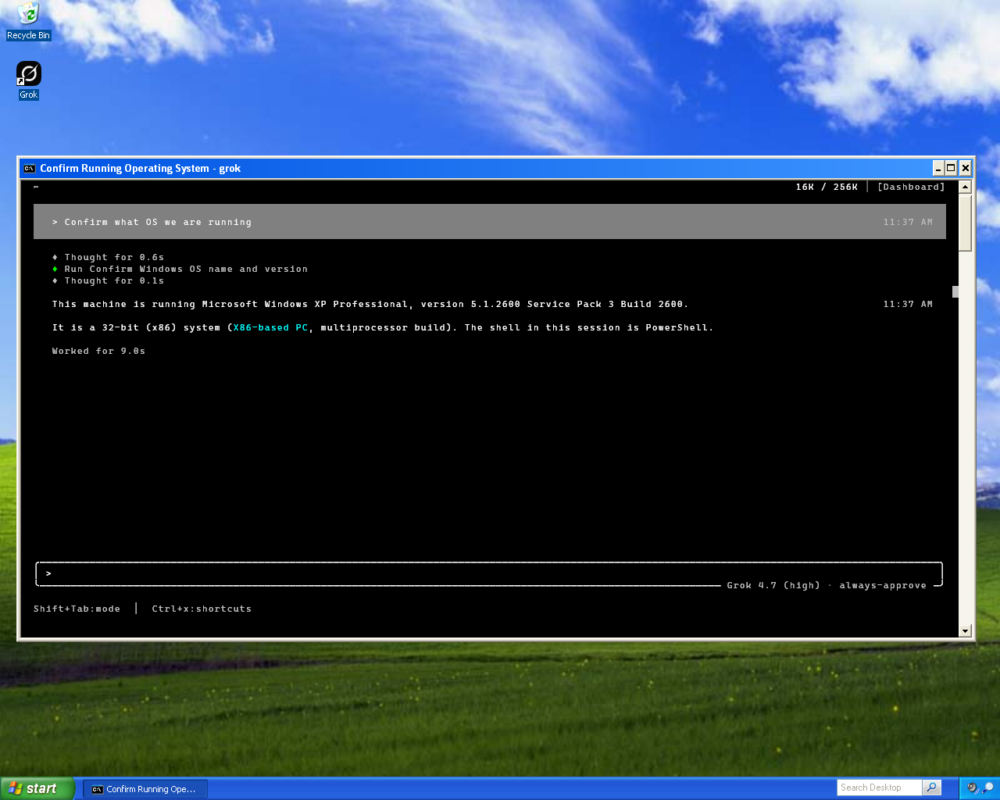

# Grok on Windows XP

This tree is the Grok Build terminal agent, built as a 32-bit program for
Windows XP SP3. The published `grok.exe` is 64-bit and does not load on XP.
The package version in this checkout is **1.0.45**.

The program is a full-screen console UI. It edits files, runs a shell, and
talks to the Grok API. Sign-in is the usual device-code flow. Settings and
the login file stay in that user's `%USERPROFILE%\.grok`.



## How it runs

The pager is a normal Win32 console program:

- 32-bit PE, subsystem 5.01, C runtime linked in. It does not need a Visual
  C++ redistributable.
- Rust's standard library is rebuilt for the `i686-win7-windows-msvc` target.
  APIs that exist only on Vista and later are satisfied by small stdcall
  shims inside the executable, so the import set matches XP's system DLLs.
- The linker is `xp-link.exe`. It calls the VS 2017 x86 linker, keeps the
  Windows 7.1A `kernel32.lib`, and forces subsystem 5.01.

XP has no virtual-terminal console mode, so the UI does not speak ANSI:

- Colors are the 16 console attributes. When XP rejects
  `ENABLE_VIRTUAL_TERMINAL_PROCESSING`, color detection stops at basic color.
- The output code page stays the OEM page. Code page 65001 is set only after
  virtual-terminal mode is accepted, which does not happen on XP.
  `WriteConsoleW` draws the text.
- Mouse clicks use the console buffer row. The output console has no
  virtual-terminal mouse origin to subtract.
- The desktop and taskbar icon is the grok.com favicon (`xp-port/installer/grok.ico`).

There is no ConPTY on XP. `CreatePseudoConsole` is not called. A shell
session is `cmd` with piped stdio. Full-screen console programs in that
session do not work. Resize and a real TTY are not available.

Network and login use the same Winsock stack as the rest of the CLI, with
XP fallbacks in the `mio` and `socket2` crates. The pager opens the sign-in
page with the default `https` handler. That default has to be a modern
browser. Internet Explorer and Firefox 52 cannot load the accounts site, so
auth does not finish while either of those is the default. Supermium 150,
32-bit, is the browser that worked here. The launcher does not choose a
browser path.

The console font is Cascadia Mono, the same family used on Windows 10. XP
only lists a TrueType face when it is named under
`HKLM\SOFTWARE\Microsoft\Windows NT\CurrentVersion\Console\TrueTypeFont`,
and it drops faces whose glyphs paint outside the cell or that GDI does not
classify as modern TrueType. The file shipped with the installer is Cascadia
Mono Regular with those metrics adjusted. The family name is still
`Cascadia Mono`. The shortcut sets that face for the pager at height 15
before the console is created.

`grok-launch.exe` starts `xp-pager.exe` in `%USERPROFILE%` with
`--no-auto-update --no-memory`. It does not set `GROK_HOME` or `TERM`.

## Build machine

Build on a 64-bit Windows machine. The XP PC only runs the finished program.

- Rust **1.94.0**, with the `rust-src` component. `rust-toolchain.toml` pins
  the channel. `cargo +1.94.0` is the command that matches this tree.
- Visual Studio 2017, toolset **v141_xp** (MSVC 14.16.27023 and the Windows
  7.1A SDK).
- `protoc` 29.3 and NASM 2.16.03 on the build `PATH`.
- `xp-link.exe` in the build directory. That directory is
  `%TEMP%\xp-rust-hello` unless `XP_BUILD` is set.
- The patched font `fonts\CascadiaMono-install.ttf` in that same directory.
  `XP_FONT` overrides the path.

Leave the cargo process's `INCLUDE` and `LIB` alone. Do not prepend the
VS 2017 `INCLUDE` directory or `Hostx64` to that process. The linker wrapper
selects the XP libraries itself. Set `PROTOC`, `NASM` on `PATH`, and
`RUSTC_BOOTSTRAP=1`.

Some crates cannot be patched through `Cargo.lock` while `--locked` is set.
`xp-port\apply-registry.ps1` copies those edits into the local cargo
registry and deletes their build fingerprints:

- `crossterm` 0.28.1 writes with `WriteConsoleW` and skips ANSI
  synchronized-update sequences.
- `mio` 1.2.1 and `socket2` 0.6.4 fall back to Winsock calls XP has.
- `cc` 1.2.48 avoids a tempfile path XP rejects.

Run that script before a build that needs those crates recompiled. A
`cargo clean`, or a fresh extract of the crates, drops the edits until the
script is run again. A link that finishes in a couple of seconds did not
recompile them.

Do not edit `Cargo.lock` to point at the patched crates. Do not fork rustc.

## Build the pager

From the repository root. `protoc` 29.3 and NASM 2.16.03 are expected under
`%TEMP%` as unpacked below, or already on `PATH`.

```powershell
& .\xp-port\apply-registry.ps1

$build = if ($env:XP_BUILD) { $env:XP_BUILD } else { Join-Path $env:TEMP 'xp-rust-hello' }
$env:Path = "$(Join-Path $env:TEMP 'protoc-29.3-win64\bin');$(Join-Path $env:TEMP 'nasm\nasm-2.16.03');" + $env:Path
$env:PROTOC = Join-Path $env:TEMP 'protoc-29.3-win64\bin\protoc.exe'
$env:RUSTC_BOOTSTRAP = '1'
$link = Join-Path $build 'xp-link.exe'
$target = Join-Path $build 'target'
cargo +1.94.0 build --locked -Z build-std=std,panic_abort --release --target i686-win7-windows-msvc -p xai-grok-pager-bin --target-dir $target --config "target.i686-win7-windows-msvc.linker='$link'" --config "target.i686-win7-windows-msvc.rustflags=['-C','target-feature=+crt-static','-C','panic=abort']"
```

The binary is `target\i686-win7-windows-msvc\release\xai-grok-pager.exe`
under the build directory.

Before copying it to an XP machine, compare its imports to a copy of that
machine's system DLLs. A good result has no missing imports.

## Build the installer

```powershell
& .\xp-port\installer\build-installer.ps1
```

That builds `xp-setup.exe` and `grok-launch.exe` with MSBuild
`v141_xp`, copies the pager, stamps the grok.com icon into the pager, and
copies the patched font. It uses the same `XP_BUILD` directory as the pager
build. `XP_PAGER`, `XP_FONT`, and `XP_MSBUILD` override the pager, the font,
and MSBuild. The folder to move to the XP machine is
`xp-port\installer\dist`:

| File | Role |
|------|------|
| `xp-setup.exe` | Installer. Also the Add/Remove Programs uninstall command. |
| `grok-launch.exe` | Shortcut target. Opens the pager in the user's profile. |
| `xp-pager.exe` | The agent. |
| `CascadiaMono.ttf` | Console font. |
| `xp-screen.exe` | Test probe used on the lab machine. The installer does not install it. |

## Install

On the XP machine, as Administrator, run `xp-setup.exe` from that folder.
`-quiet` skips the closing pause. `-log C:\path\install.log` writes a log.

Setup copies the program to `%ProgramFiles%\Grok`, registers Cascadia Mono,
adds it to the console font list if the name is not already there, and
creates a Grok shortcut on the common desktop and the common Start menu.
On the lab machine those common folders are under `All Users.WINDOWS`.

Before the first sign-in, make a modern browser the default for `https`.
The pager opens the accounts page in that default browser, and an old
default (Internet Explorer or Firefox 52) cannot complete auth. Supermium
150, 32-bit, is the one that worked on the lab machine.

The shortcut runs `grok-launch.exe`. The first launch for each user writes
the console face for `xp-pager.exe` and then starts it. Sign in from the
window. Quit with `ctrl+q`.

Uninstall from Add/Remove Programs, or run:

```bat
"%ProgramFiles%\Grok\xp-setup.exe" -uninstall -quiet
```

Uninstall removes the program files and the shortcuts. It leaves
`%USERPROFILE%\.grok` in place, including the login.

## What this port does not change

The agent, tools, and prompts are the Grok Build CLI from this checkout.
XP does not gain ConPTY, virtual-terminal color, or a 64-bit address space.
The binary is about 139 MB. A machine with very little RAM will struggle,
especially with a current browser open beside it.

First-party code is Apache License 2.0. See `LICENSE`. Cascadia Mono is
under the SIL Open Font License. Third-party notices are in
`THIRD-PARTY-NOTICES`.
